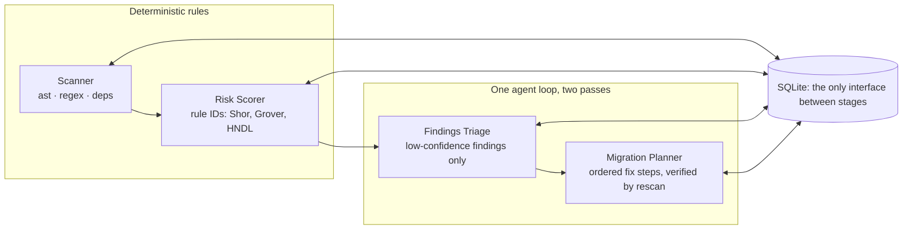

# Agentic PQC Migration Adviser

> **Status:** v0.1.1-foundations. This release contains the ML-KEM (FIPS 203)
> key-exchange groundwork. The agent is planned for v0.4, not yet built.

## The problem
Organisations face hard post-quantum migration deadlines. US federal systems
must migrate key establishment by 2030 and signatures by 2031. The UK NCSC
roadmap sets planning by 2028, high-priority upgrades by 2031, and full
migration by 2035. Most teams don't know where classical cryptography lives
in their codebases, or which usages to fix first.

This tool will scan a codebase, flag classical crypto usage, and produce a
risk-ranked migration roadmap mapped to NIST's PQC standards.

## Planned architecture


| Stage | Rules or LLM | What it does | Output | Milestone |
|---|---|---|---|---|
| Scanner | Rules | Finds classical cryptography in three layers: Python call sites through ast (high confidence), declared and locked dependencies (medium), and regex over text and config files (low). | Findings with file, detection rule, fingerprint, line, key size, confidence, etc; stored in SQLite. | v0.2 |
| Risk Scorer | Rules | Assigns a risk tier to every finding assuming they are real crypto usage: RSA/ECC → critical (Shor's algorithm); symmetric → lower priority (Grover's algorithm). Scored before triage so wrongly excluded high-risk findings can be flagged for human review. | Outputs a risk tier per finding, the rule IDs that fired, and the FIPS replacement from the lookup table. | v0.3 |
| Findings Triage | LLM | Checks: 'is this real crypto usage?' per low-confidence finding. | The output is a verdict (include, exclude or needs-human) with a reason and the evidence lines. Nothing is deleted, and excluded findings still appear in the report. | v0.4 |
| Migration Planner | LLM | Read the scored, triaged findings and review the context; deterministically looks up the corresponding post-quantum algorithm replacement and orders the steps based on risk-tier, code dependencies and operation type. Drafts fixes and verifies each with a rescan. | `the output is ordered fix steps, each linked to its findings and verified by a rescan. | v0.4 |

The orchestration is hand-rolled, without an agent framework. It uses a local
LLM through Ollama, so no API keys leave the machine.

## Repository layout
`foundations/` holds the v0.1 ML-KEM handshake groundwork, meaning the handshake, framing, client and server modules, with their tests in `tests/foundations/`.
`src/agentic_migration_adviser/` is the actual migration tool, where the Scanner, Risk Assessor and Planner will live.
I split them since the demo was for learning ML-KEM and isn’t part of the tool itself. Keeping it separate stops it mixing with the product code.

```text
foundations/                      # v0.1: ML-KEM handshake demo
tests/foundations/
src/agentic_migration_adviser/    # the migration tool (Scanner onwards)
tests/scanner/                    # coming in v0.2
```

## What's in this release
- `foundations/handshake.py`: the algorithm is set by the ALGORITHM constant (currently ML-KEM-768, tests adapt accordingly) KeyGen → Encaps → Decaps using liboqs-python.
- `foundations/client.py`/`foundations/server.py`: Handshake split over TCP sockets. The client
  generates the keypair and the server encapsulates, mirroring how TLS 1.3
  hybrid key exchange (X25519MLKEM768) carries the public key in the
  ClientHello and returns the ciphertext in the ServerHello.
- `tests/foundations/test_framing.py`: round trips, message boundaries, fragmented delivery, early disconnects, oversized headers
- `tests/foundations/test_handshake.py`: matching shared secrets, implicit rejection of tampered ciphertext, key/ciphertext/secret sizes checked against liboqs, wrong-size input errors, fresh keypair per client
- `tests/foundations/test_socket_handshake.py`: matching secrets over TCP, server rejecting a wrong-size public key, client failing fast with no server, server timing out a silent client

## Quick start
Requires Python >=3.10 and
[uv](https://docs.astral.sh/uv/). On macOS, liboqs needs `brew install cmake ninja`.

    git clone https://github.com/JacobProwse/Agentic-Migration-Adviser.git
    cd Agentic-Migration-Adviser
    uv sync
    uv run python foundations/server.py & sleep 1 && uv run python foundations/client.py
    uv run pytest -q

## Example output

```text

Server listening on ('127.0.0.1', 65432)
Connected to server at 127.0.0.1:65432
Connection from: ('127.0.0.1', 63012)
Server hashed shared secret snippet: ba1a49dc2b7b70bc...
Client hashed shared secret snippet: ba1a49dc2b7b70bc...
21 passed in 0.54s

```

For reference, FIPS 203 specifies these ML-KEM-768 (current set algorithm) sizes: public key 1184 B,
ciphertext 1088 B, shared secret 32 B.

## Design decisions
- **pyproject.toml + uv** over requirements.txt, for a lock file and reproducible installs.
- **Sockets rather than an in-process split:** I chose to prioritise learning value (framing, blocking I/O, connection lifecycle) over ~4 hrs extra cost. Bonus: Potential reuse in project 2.
- **Client generates the keypair, server encapsulates:** this matches the real TLS 1.3 hybrid flow (however I only used ML-KEM not hybrid).

## What I learned
- Where a rule should live matters as much as the rule itself. I initially considered enforcing the exact public key size in the framing layer. Instead, the framing layer checks against a generic 1 MiB cap, on both send and receive, whilst the handshake layer checks the exact public key. The revision came from the principle that lower layers should provide mechanism, whilst higher layers decide policy. The principle ensures that the behaviour of lower layers is independent of the process which sits above it. If the algorithm changes in later development the framing module doesn't need adjusting.
- A test that can't fail gives false confidence. I thought running two handshakes and asserting their secrets differ would ensure that each client generates a fresh keypair. Then, I realised that the test would have passed even if the client reused its keypair, because encaps adds its own randomness. Instead, I produced a unit test that directly compares the public keys of two Client instances. Now, before trusting a test, I make sure to try at least one mutation check to make sure that a test really can fail; using git restore to make sure the deliberate break never gets committed.
- The liboqs library handles the maths, not the protocol. It made generating keys & ciphertexts easy for running a basic procedural program. However, I had to provide the framework by splitting protocol roles between the client/server sockets, verifying implicit rejection of a tampered ciphertext (since decaps returns a wrong secret with no exception) and more.

## Limitations & roadmap
- This is a key-exchange demo, not TLS. The handshake is unauthenticated,
  and a real deployment would need signatures such as ML-DSA.
- [x] GitHub Actions CI (pytest + ruff)
- [ ] Scanner Tool + SQLite findings store
- [ ] Risk Scorer Rules
- [ ] Findings Triage Tool
- [ ] Migration Planner Agent + orchestrator
- [ ] Dockerfile for one-command setup
- [ ] Support for codebases beyond Python

## Tech stack
```text
Used: python, liboqs-python (Open Quantum Safe), NIST ML-KEM, uv, GitHub Actions.
Planned: SQLite, Ollama, Docker.
```